# Manual de usuario

## Raíces del Fogón
### Sistema de información web para restaurante

| | |
|---|---|
| Institución | Colegio Parroquial San Luis Gonzaga |
| Programa | Técnico en Programación de Software — SENA, Regional Distrito Capital |
| Ficha | 3166425 |
| Integrante | Valentina Combita Durango |
| Versión | 1.1 — octubre de 2026 |

---

## 1. Introducción

Raíces del Fogón es la página web de un restaurante de comida tradicional colombiana. En ella los visitantes pueden ver el menú, los clientes pueden hacer pedidos y consultar su estado, y el administrador puede manejar los platos, las categorías y los pedidos, y ver reportes de ventas.

## 2. Objetivo del manual

Explicar paso a paso cómo usar cada parte del sistema, tanto para los clientes como para el administrador, cómo interpretar los mensajes que muestra la aplicación y qué hacer ante los problemas más comunes.

## 3. Requisitos para usar la aplicación

- Un computador, tableta o celular con un navegador actualizado (Chrome, Edge, Firefox o Safari).
- La aplicación debe estar encendida. En el equipo de desarrollo se abre en **http://localhost:5173**; el responsable técnico debe iniciar antes la API y MySQL (ver el archivo `README.md`).
- Para hacer pedidos: una cuenta de cliente (se crea gratis en la misma página).
- Para administrar: la cuenta de administrador que se crea al instalar el sistema.

## 4. Acceso a la aplicación

1. Abra el navegador y escriba la dirección de la aplicación.
2. Verá el **Menú**. No necesita iniciar sesión para consultarlo.
3. Para hacer pedidos, use **Registrarse** (primera vez) o **Iniciar sesión** en la barra superior.

## 5. Descripción de la interfaz

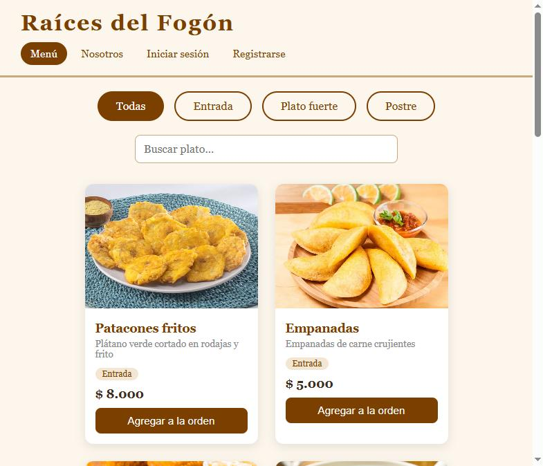

- **Barra superior:** el nombre del restaurante (lleva al menú) y los enlaces de navegación. La opción en la que está aparece resaltada en color café.
- **Filtros de categoría:** botones *Todas*, *Entrada*, *Plato fuerte* y *Postre*.
- **Buscador:** encuentra platos por nombre o descripción.
- **Tarjetas de platos:** foto, nombre, descripción, categoría, precio y el botón **Agregar a la orden**.
- **Panel Orden:** aparece al agregar el primer plato.
- **Pie de página:** nombre y lema del restaurante.

## 6. Navegación entre páginas

| Opción | Quién la ve | Para qué sirve |
|---|---|---|
| Menú | Todos | Ver los platos y armar la orden |
| Nosotros | Todos | Misión, visión, objetivos, valores y servicios |
| Iniciar sesión / Registrarse | Visitantes | Entrar o crear una cuenta |
| Mis pedidos | Clientes | Historial y estado de sus pedidos |
| Platos, Categorías, Pedidos, Reportes | Administrador | Gestión del restaurante |
| Cerrar sesión | Usuarios con sesión | Salir de la cuenta |

En el celular, los enlaces se esconden en el botón **Menú** de la esquina superior derecha. Púlselo para abrirlos y pulse **Cerrar** para ocultarlos.

| Celular: menú | Celular: navegación abierta |
|---|---|
| 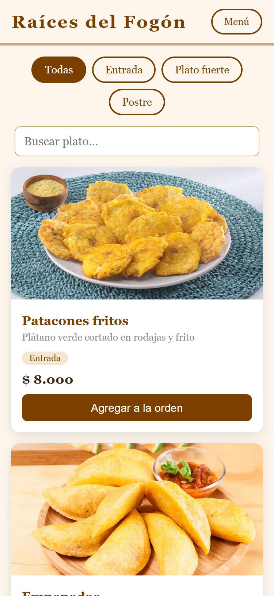 | 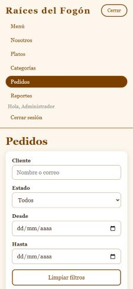 |

## 7. Uso de cada módulo

### 7.1 Nosotros

Muestra la presentación de la empresa, la misión, la visión, el objetivo general, los objetivos específicos, los valores y los servicios.

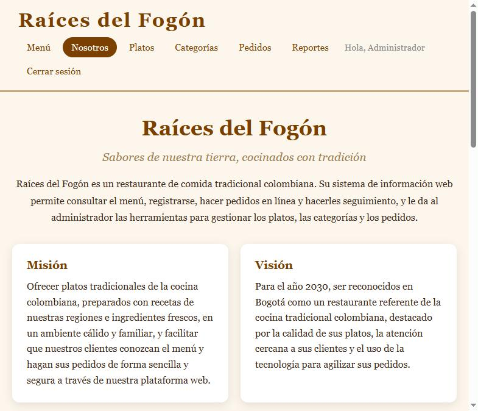

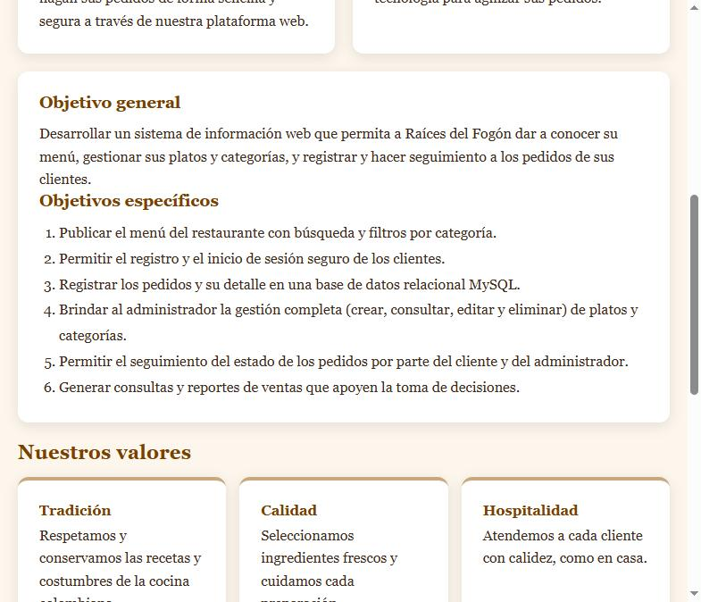

### 7.2 Registro de clientes

1. Pulse **Registrarse**.
2. Complete **Nombre completo**, **Correo electrónico**, **Teléfono**, **Contraseña** y **Confirmar contraseña**. Los campos con asterisco (*) son obligatorios.
3. Pulse **Registrarme**. Si los datos son correctos, la cuenta se crea, la sesión se inicia sola y vuelve al menú.

Si falta algún dato o tiene un formato incorrecto, el campo se marca en rojo y aparece el motivo debajo:

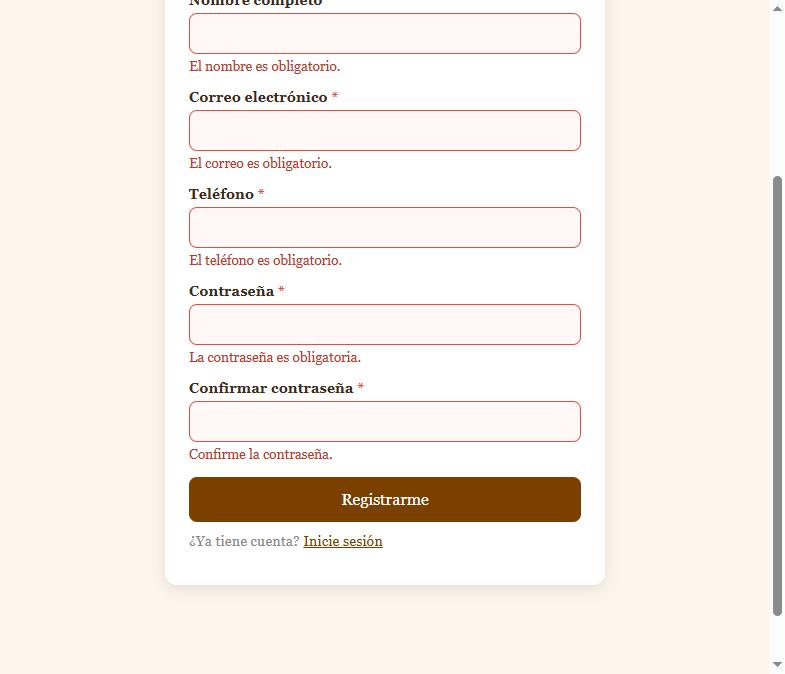

### 7.3 Inicio de sesión

1. Pulse **Iniciar sesión**.
2. Escriba su correo y su contraseña y pulse **Ingresar**.
3. Los clientes vuelven al menú y el administrador entra a **Gestión de platos**.

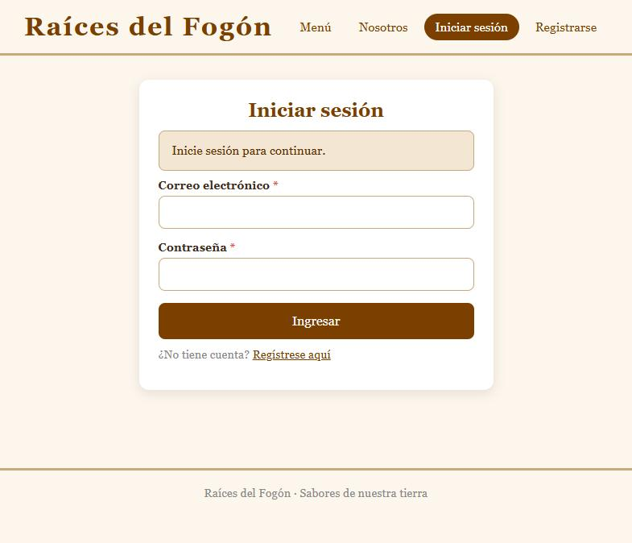

Si intenta abrir una página que requiere sesión, la aplicación lo trae aquí con el aviso "Inicie sesión para continuar."

### 7.4 Hacer un pedido (cliente)

1. En el **Menú**, pulse **Agregar a la orden** en cada plato que quiera. Puede filtrar por categoría o usar el buscador.
2. En el panel **Orden**:
   - **+** y **−** cambian la cantidad (máximo 50 por plato).
   - **Eliminar** quita un plato.
   - **Vaciar** quita todos los platos.
   - **Observaciones** (opcional) sirve para indicaciones como "sin cebolla".
3. Revise el **Total** y pulse **Pedir**.
4. Si no ha iniciado sesión, la aplicación lo lleva a **Iniciar sesión** y conserva su orden para enviarla al volver.

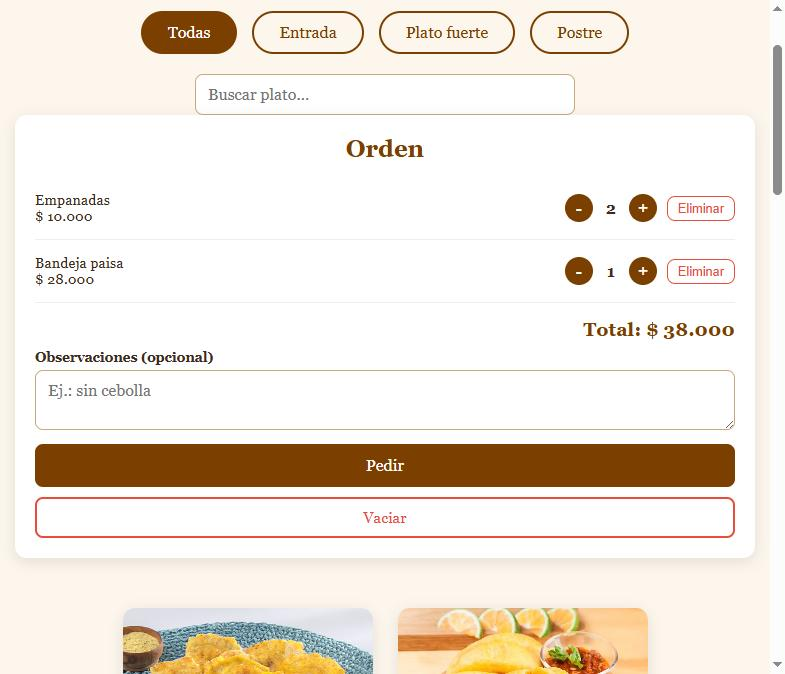

Cuando el pedido se guarda, aparece el aviso verde **"Pedido #N confirmado"** con el enlace **Ver pedido**, y la orden queda vacía:

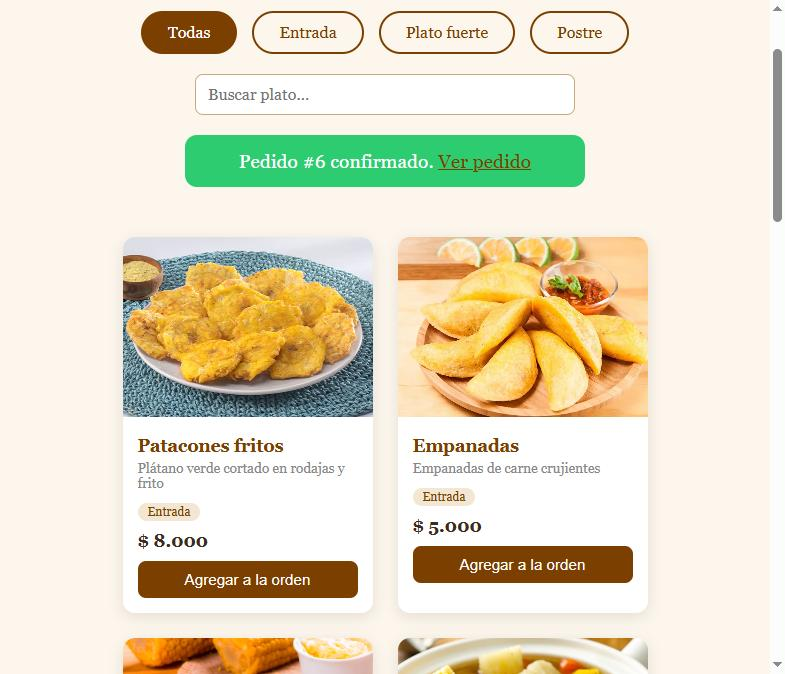

### 7.5 Mis pedidos (cliente)

1. Pulse **Mis pedidos** para ver la lista con el número, la fecha, la cantidad de platos, el total y el estado.
2. Pulse **Ver detalle** para ver los platos, su categoría, la cantidad, el precio unitario y el subtotal.
3. Si el pedido está **Pendiente**, puede pulsar **Cancelar pedido** y confirmar.

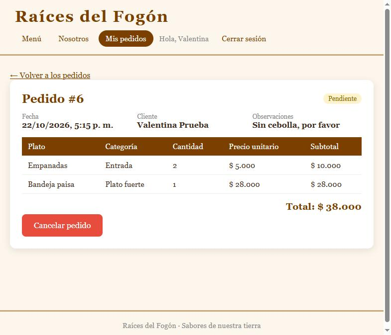

Estados de un pedido: **Pendiente** (recibido), **En preparación**, **Entregado** y **Cancelado**.

### 7.6 Gestión de platos (administrador)

Es el módulo principal, con creación, consulta, edición y eliminación.

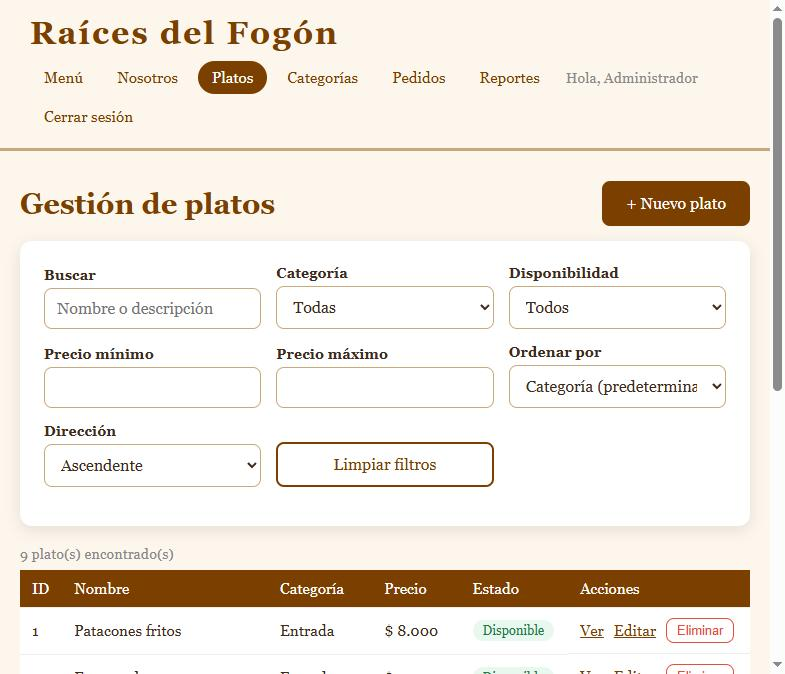

## 8. Procedimiento para crear registros

**Crear un plato**

1. En **Platos**, pulse **+ Nuevo plato**.
2. Complete **Nombre**, **Descripción** (mínimo 10 caracteres), **Precio (COP)** y **Categoría**.
3. En **Foto del plato** (opcional) tiene dos formas de poner la foto:
   - **Subir foto desde el equipo:** pulse **Seleccionar archivo** y elija una foto **JPG, PNG o WEBP de máximo 2 MB**. Verá la vista previa y el nombre del archivo; con **Quitar selección** puede elegir otra.
   - **O use la URL de una imagen:** pegue la dirección de una foto publicada en internet (debe empezar por `https://`).
   Si usa las dos, el menú muestra la foto subida.
4. Deje marcada la casilla **Disponible en el menú** si quiere que el plato aparezca para los clientes.
5. Pulse **Crear plato**. Si eligió una foto, el botón dice "Guardando y subiendo foto…". Volverá al listado con el aviso "Se creó …".

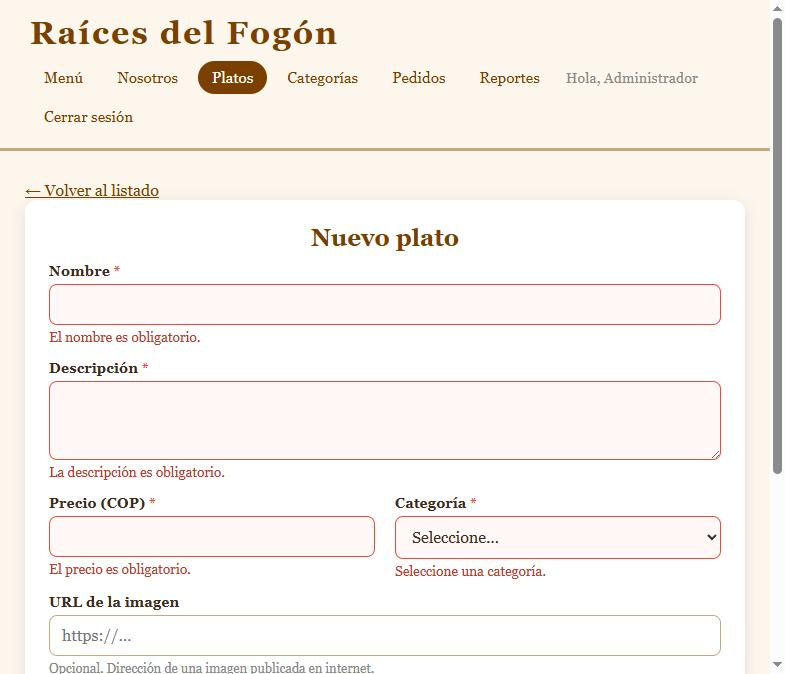

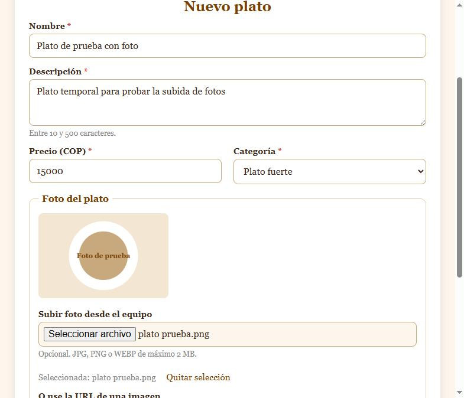

La foto subida aparece en la tarjeta del plato en el **Menú**:

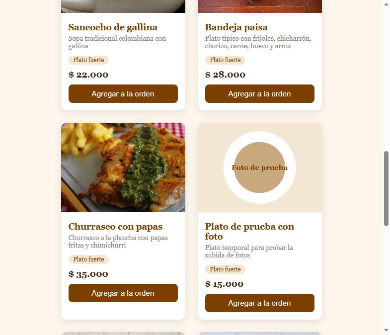

Si los datos se guardan pero la foto no se puede subir (por ejemplo, por una falla de conexión), la aplicación lo avisa y abre el plato en modo edición para que intente subir solo la foto otra vez.

**Crear una categoría**

1. En **Categorías**, escriba el **Nombre** (y, si quiere, la **Descripción**) en el formulario **Nueva categoría**.
2. Pulse **Crear categoría**. Aparecerá en la tabla con el aviso "Categoría creada."

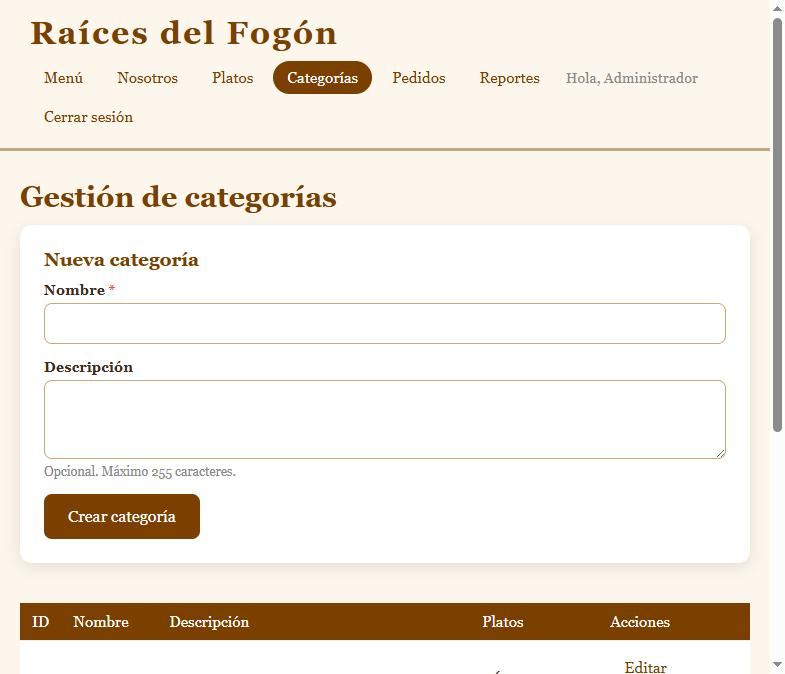

## 9. Procedimiento para consultar y buscar información

**Platos (administrador).** En **Platos** puede combinar varios filtros; la lista se actualiza sola mientras escribe o elige:

- **Buscar:** texto en el nombre o la descripción.
- **Categoría** y **Disponibilidad** (disponibles / no disponibles).
- **Precio mínimo** y **Precio máximo**.
- **Ordenar por** nombre, precio o fecha de creación, en dirección **Ascendente** o **Descendente**.
- **Limpiar filtros** vuelve a mostrar todo.

Pulse **Ver** en una fila para la consulta individual del plato: datos completos, número de pedidos en los que aparece y unidades vendidas.

**Pedidos (administrador).** En **Pedidos** puede filtrar por **Cliente** (nombre o correo), **Estado** y rango de fechas (**Desde** / **Hasta**). Arriba de la tabla verá cuántos pedidos hay y el valor de las ventas sin contar los cancelados.

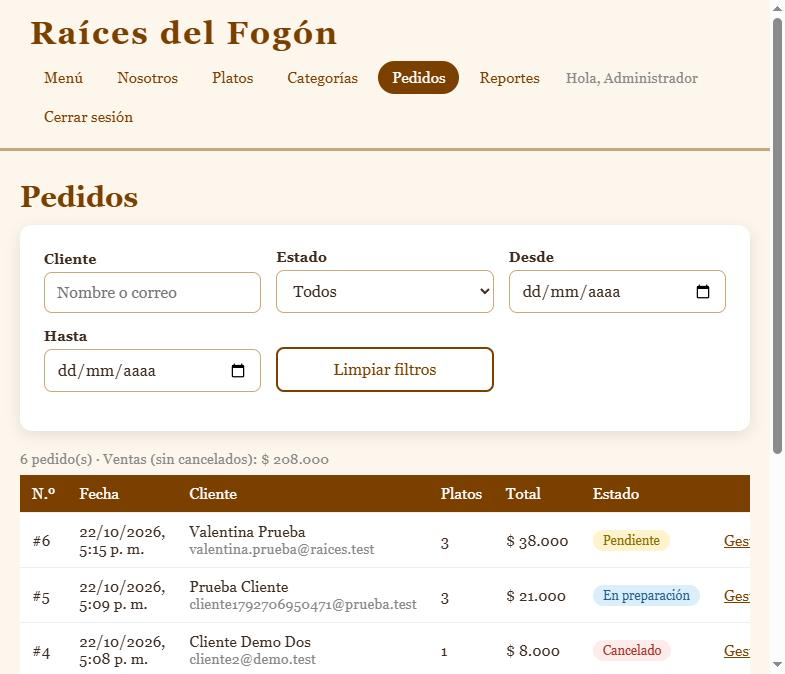

**Reportes (administrador).** Muestra el total de pedidos, las ventas, el ticket promedio, los clientes con pedidos, los platos más vendidos, los pedidos por estado y los precios por categoría.

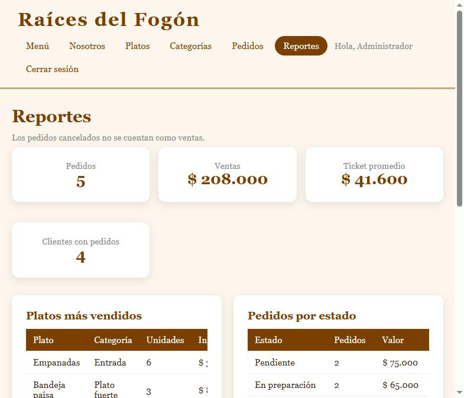

## 10. Procedimiento para editar registros

**Editar un plato**

1. En **Platos**, pulse **Editar** en la fila del plato (o **Editar** dentro de **Ver**).
2. El formulario se abre con los datos actuales. Cambie lo necesario.
3. Pulse **Guardar cambios**. Volverá al listado con el aviso "Se actualizó …".

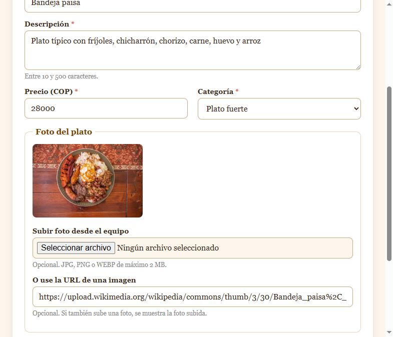

**Cambiar la foto de un plato**

- **Reemplazar:** en **Editar**, use **Reemplazar foto**, elija la nueva y pulse **Guardar cambios**. La foto anterior se elimina del servidor.
- **Quitar:** pulse **Quitar foto subida** y confirme. El archivo se elimina del servidor; si el plato tenía una URL de imagen, vuelve a mostrarse esa.

En **Ver** (consulta del plato), el dato **Foto** indica si la foto está subida al servidor (con el nombre del archivo original), si es una URL externa o si el plato no tiene foto.

**Editar una categoría:** en **Categorías**, pulse **Editar** en la fila; el formulario de la izquierda cambia a **Editar categoría**. Pulse **Guardar cambios** o **Cancelar**.

**Cambiar el estado de un pedido:** en **Pedidos**, pulse **Gestionar** y elija el nuevo estado en **Cambiar estado**. Se guarda de inmediato y aparece el aviso "El pedido quedó en estado …".

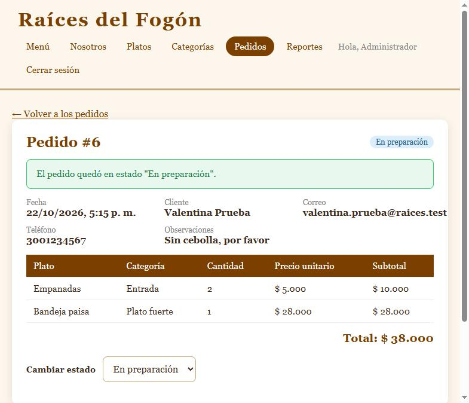

## 11. Procedimiento para eliminar registros

1. En **Platos** (o **Categorías**), pulse **Eliminar** en la fila.
2. El navegador pedirá confirmación: "¿Eliminar definitivamente …? Esta acción no se puede deshacer." Pulse **Aceptar** para eliminar o **Cancelar** para conservarlo.
3. Aparecerá el aviso "Se eliminó …" y la tabla se actualizará.

Por seguridad de la información:

- Al eliminar un plato, también se elimina su foto subida.
- Un **plato que ya aparece en pedidos** no se puede eliminar. Para quitarlo del menú, edítelo y desmarque **Disponible en el menú**.
- Una **categoría que tiene platos** no se puede eliminar. Primero mueva los platos a otra categoría o elimínelos.
- Los clientes no eliminan pedidos: los **cancelan** mientras estén pendientes.

## 12. Registro e inicio de sesión

Ver las secciones 7.2 y 7.3. Para salir, pulse **Cerrar sesión** en la barra superior; volverá al menú. La sesión también se cierra sola después de 8 horas.

## 13. Mensajes de validación

| Mensaje | Qué significa | Qué hacer |
|---|---|---|
| "El nombre es obligatorio." (y similares) | El campo está vacío | Complételo |
| "Escriba un correo válido, por ejemplo nombre@correo.com." | El correo está mal escrito | Revise la @ y el dominio |
| "El teléfono debe tener entre 7 y 15 dígitos." | El teléfono tiene letras o muy pocos números | Escriba solo números |
| "La contraseña debe tener entre 8 y 72 caracteres." / "…debe combinar letras y números." | Contraseña débil | Use al menos 8 caracteres con letras y números |
| "Las contraseñas no coinciden." | La confirmación es distinta | Escríbala de nuevo |
| "Este correo ya está registrado." | Ya existe una cuenta con ese correo | Inicie sesión con esa cuenta |
| "Correo o contraseña incorrectos." | Los datos de acceso no coinciden | Revise ambos datos |
| "Demasiados intentos fallidos. Espere 15 minutos e intente de nuevo." | Se escribió mal la contraseña 5 veces desde este equipo (protección contra ataques) | Espere 15 minutos; al entrar correctamente el contador se reinicia |
| "El precio debe estar entre $500 y $1.000.000." | Precio fuera de rango | Corrija el valor |
| "La imagen debe ser una URL que empiece por http:// o https://." | Dirección de imagen inválida | Pegue una URL completa o deje el campo vacío |
| "Use una foto JPG, PNG o WEBP." / "Formato no permitido…" | El archivo no es una foto en esos formatos (o está dañado) | Elija otra foto o conviértala a JPG |
| "La foto debe pesar como máximo 2 MB." | La foto es muy pesada | Redúzcala (por ejemplo, con la opción de cambiar tamaño de su editor de imágenes) |
| "Máximo 6000 px por lado." | La foto tiene dimensiones excesivas | Reduzca su tamaño en píxeles |
| "Ya existe un registro con ese valor." | Nombre de plato o categoría repetido | Use otro nombre |
| "Este plato ya aparece en pedidos, por eso no se puede eliminar…" | El plato tiene ventas | Márquelo como no disponible |
| "Uno o más platos ya no están disponibles. Actualice su orden." | Un plato se ocultó mientras armaba la orden | Quítelo de la orden |
| "Solo se pueden cancelar pedidos en estado pendiente." | El pedido ya se está preparando o fue entregado | Comuníquese con el restaurante |
| "No tiene permisos para ver esta página." | Entró a una página de administrador con una cuenta de cliente | Use la cuenta de administrador |

## 14. Solución de problemas comunes

| Problema | Posible causa | Solución |
|---|---|---|
| "No hay conexión con el servidor. Verifique que la API esté encendida." | La API PHP está apagada | Ejecute `npm run api` (ver `README.md`) |
| "La base de datos no está disponible. Intente más tarde." | MySQL está apagado o el `.env` tiene datos errados | Encienda MySQL (Laragon/XAMPP) y revise el `.env` |
| El menú aparece vacío | No se instalaron los datos iniciales, o todos los platos están no disponibles | Ejecute `npm run db:setup` o revise la disponibilidad en **Platos** |
| Una foto no se ve | La URL de la imagen dejó de existir, o se borró la carpeta `uploads/platos/` del servidor | Edite el plato y suba la foto de nuevo o cambie la URL |
| No puedo subir una foto grande aunque pese menos de 2 MB | El servidor tiene un límite menor en `php.ini` | El responsable técnico debe revisar `upload_max_filesize` y `post_max_size` |
| Al pulsar **Pedir** me envía a iniciar sesión | No hay sesión iniciada | Inicie sesión: su orden se conserva |
| No veo las opciones de administración | La cuenta es de cliente | Ingrese con la cuenta de administrador |
| La sesión se cerró sola | Pasaron 8 horas | Inicie sesión de nuevo |

## 15. Recomendaciones de uso

- Cierre la sesión al terminar, sobre todo en equipos compartidos.
- Use una contraseña que no utilice en otros sitios.
- En lugar de eliminar un plato que ya se vendió, márquelo como **no disponible**: así se conserva el historial de ventas.
- Prefiera subir las fotos de los platos al servidor en lugar de usar URL de otros sitios: así no dependen de páginas externas que pueden cambiar o desaparecer.
- Incluya la carpeta `uploads/` en las copias de seguridad, junto con la base de datos.
- Revise el panel **Orden** y el **Total** antes de pulsar **Pedir**.
- Actualice el estado de los pedidos a medida que avanzan para que los clientes puedan seguirlos.
- Guarde el archivo `.env` en un lugar seguro y no lo comparta.
